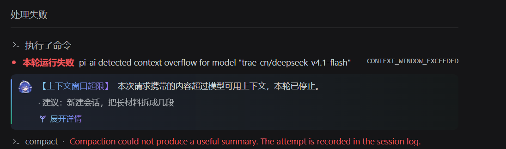
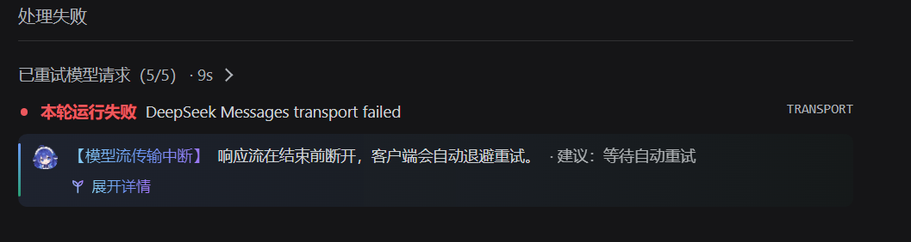
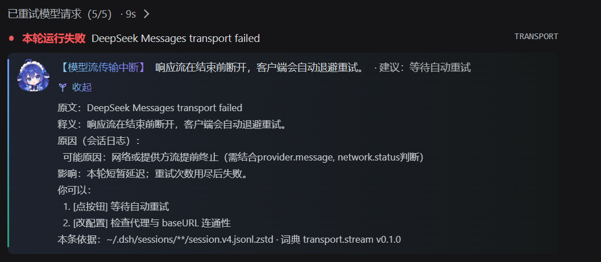

# dsh-error-gloss


给 DeepSeek Harness 的每一条报错，加一行中文释义。

官方客户端只把 6 个错误码本地化成中文，其余一律原样透传英文。这个插件补上剩下的部分：**每个错误码都有中文标题、一句释义、影响说明，和能直接照做的建议**；英文原文、原始 `code` 标签、官方原有的报错行全部完整保留，不替换、不遮挡。

```
本轮运行失败  pi-ai detected context overflow for model "trae-cn/deepseek-v4.1-flash"  [CONTEXT_WINDOW_EXCEEDED]
【上下文窗口超限】本次请求携带的内容超过模型可用上下文，本轮已停止。 · 建议：新建会话，把长材料拆成几段   展开详情
```

## 效果

报错行原样保留，中文注解另起一行挂在下方，不替换、不遮挡官方内容：



会话中途断流这类"没头没尾"的英文，也一样有中文标题和一句能照做的建议：



点开「展开详情」，原文、释义、原因（带可信度）、影响、建议、依据六段都在，仍是原文优先：



---

## 它覆盖到哪

共 **40 条词条**，分两层：

| 层 | 条数 | 覆盖 |
|---|---|---|
| 精确词条 | 29 | 每个码一条，含具体释义与建议（上下文溢出、6 条压缩失败分支、认证/额度/限流、密钥、图片、超时、中止、子任务续跑…） |
| 码族 | 11 | `TEAM_*`、`GOAL_*`、`ASK_*`、`SESSION_*`、`ATTACHMENT_*`、`WEB_*`、`SANDBOX_*`、`ACTIVATION_*`、模型适配器、授权流程、工具调用 |

**官方码这一侧零未收录。** 唯一还会显示「原因未验证」的是服务端自己写的自由文本（比如 `INVALID_REQUEST` 的详情），那种没有码，谁也枚举不了——插件会把原文完整留着，只加中文释义，不猜原因。

## 三条设计原则

**1. 按 code 路由，不解析文案。** 官方 `HarnessError` 的注释写得很直白：`route on this, never by parsing message`。适配器措辞随时会变，码相对稳定。匹配顺序：精确码 → 码族 → 文案模板 → 兜底。

**2. 原因分三档，不确定就说不确定。**

| 档 | 界面表现 | 用在哪 |
|---|---|---|
| 确定 | 原因：因为 …（附依据） | 码的直接含义，如「压缩被取消」 |
| 可能 | 可能原因：…（需结合 token 用量判断） | 需要上下文才能判定的，如上下文溢出 |
| 未验证 | 原因未验证 —— 这条文案来自服务端 | 自由文本、码族（只知道属于哪个模块） |

宁可说「不知道」，也不给一个假的归因。码族词条一律是 `forbidden`：它只回答「这属于哪个功能模块、跟模型/网络有没有关系」，具体原因让你看原文。

**3. 任何异常都不许影响宿主。** 客户端插件的 `apply()` 抛错会让整个 DSH 起不来。所以每一步注册都单独兜异常，注册失败只记账、并在设置页用红框显示，绝不冒泡。

## 装

首发走官方插件通道：

```bash
dsh plugin --profile desktop add dsh-error-gloss
```

装完在 **设置 → 报错中文注解** 里能看到版本、已加载词条数、命中计数，还有一个「自测」按钮——点一下用内置样本渲染一条完整注解，零请求零模型调用，用来确认装上了。

卸：

```bash
dsh plugin --profile desktop remove dsh-error-gloss
```

## 隐私

- **零遥测**：没有任何统计上报，没有账号、没有设备 ID。
- **零模型调用**：注解全部来自本地词典，不会为了翻译报错再发一次请求（上下文已经溢出的场合，那只会更糟）。
- **零网络出口**：插件不发起任何网络请求。
- **不写会话记录**：注解只进界面投影层，不改动 transcript。
- **脱敏**：任何进入日志的内容都先过一遍脱敏（密钥、Bearer、UUID、request_id、绝对路径、手机号）。

## 兼容性

- 面向 DeepSeek Harness 0.2.1-rc.2 实测。插件只用官方公开扩展点：`dsh.client` 清单、`ctx.locale.register`、`ctx.slots.inject` / `ctx.slots.register`。**零内核改动、零 fork。**
- 词典条目各自带 `dshVersionRange`，跨版本的词条会被标 `stale` 并跳过，不会拿旧文案套新报错。

## 自己改词条

词典是纯数据（`catalog/entries/*.json`），一条一个文件，改了重建即可：

```bash
node tools/build-client.mjs      # 打包
node src/selftest.mjs            # 引擎自检
node client/bundle-test.mjs      # 客户端装载
```

用户级覆盖放在 `~/.dsh/error-gloss.user.json`，按 `id` 做字段级合并；`causeAssertion` 是**单向锁定**的——你可以把「确定」降级成「可能」，不能反过来。

## 许可

本仓库含**两套许可**，请分别看待：

| 范围 | 许可 | 说明 |
|---|---|---|
| 代码、词典数据、构建脚本 | **MIT**（见 [LICENSE](LICENSE)） | 随便用，包括商用 |
| 界面里的角色形象与首图（`client/assets/`、`client/icon.png`、`assets/`） | **CC BY-NC-SA 4.0** | 不可商用、需署名、衍生作品同许可 |

角色形象「大肥鱼」由 **ZipZipPipe**（B 站）创作，以 CC BY-NC-SA 4.0 释出。本项目对它做了抠图、裁切、缩放，属于衍生作品，同样以 CC BY-NC-SA 4.0 提供。作者明确声明**该形象不可以任何形式商业化**。

完整范围、商用边界、移除方式与 Takedown 流程见 [`PROVENANCE.md`](PROVENANCE.md)。

如果你要在商业场景使用本插件：删掉 `client/assets/` 与 `client/icon.png` 后重新运行 `node tools/build-client.mjs`，插件会自动回落到原创的鲸尾徽章（纯 SVG），代码部分仍是 MIT。

本项目与 DeepSeek 官方无关，未包含也未修改任何官方代码。详见 [NOTICE.md](NOTICE.md)。
